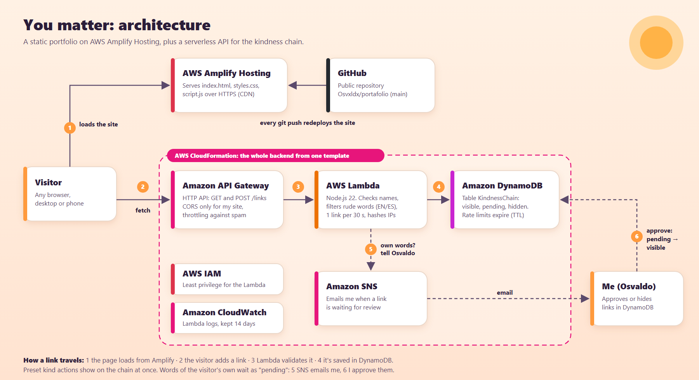

# You matter: Osvaldo's portfolio

My portfolio for the **AWS Student Builder Challenge**. It tells my story, shows my skills and projects, and ends with a live **kindness chain**: visitors add one small, good thing they'll do today, and everyone sees it.

> Everyone matters the same, so every link on the chain is the same size.

## What's on the page

- **Hero:** who I am and what I do, over a sunrise that reacts to your mouse, plus a live count of kind actions.
- **About me, skills, experience and projects:** a business intelligence internship at MBQ Group, Prometheus (Top 20 of 111 at the Salesforce Agentic AI Hackathon), a freelance water utility system, and this site.
- **My journey:** a path from September 2024, when I knew nothing about tech, to today. It starts at night and the sky turns to sunrise at the moment I found my passion for data science.
- **The story behind my smile:** a short personal story you can open if you want to.
- **Your turn:** the kindness chain, the interactive feature. Because you matter.

There's also a sunrise and night theme, a custom cursor that sparks when you click, and smooth scrolling. If your system asks for reduced motion, the page keeps gentle effects (light, fades, sparks) and turns off sliding, bouncing and parallax. Everything works with a keyboard.

## How it's built



- **Frontend:** plain HTML, CSS and JavaScript with no build step. GSAP, ScrollTrigger and Lenis load from a CDN for animation and smooth scrolling. The page still works if they don't load.
- **AWS Amplify Hosting:** deploys the site from this repository on every push (see `amplify.yml`).
- **Amazon API Gateway (HTTP API):** `GET /links` and `POST /links`, with CORS limited to my site and throttling.
- **AWS Lambda:** checks names and actions, blocks rude words in English and Spanish (also written with numbers, spaces or stretched letters), blocks links and phone numbers, and limits each visitor to one link every 30 seconds. IP addresses are hashed before they're stored.
- **Amazon DynamoDB:** stores the links. Rate-limit records expire on their own with TTL.
- **Amazon SNS:** emails me when a link needs review.
- **AWS IAM and Amazon CloudWatch:** a least-privilege role for the Lambda, and its logs.
- **AWS CloudFormation:** `infra/kindness-chain.yaml` creates the whole backend in one step.

### Keeping the chain kind

Preset kind actions go on the chain right away. A link written in the visitor's own words is saved as `pending`: only its author sees it, marked "in review", until I approve it by changing `status` to `visible` in the DynamoDB console. To remove any link, I set its `status` to `hidden`.

## Run it locally

Open `index.html` through any static server. With `CHAIN_API_URL` empty in `config.js`, the chain runs in preview mode and saves links only in your browser.

Add `?motion=full` to the URL to see every animation on a computer that has reduced motion turned on.

## Backend

```bash
node infra/lambda/test.js   # run the Lambda tests
node infra/build.mjs        # rebuild infra/kindness-chain.yaml after editing the Lambda
```

Deploy `infra/kindness-chain.yaml` as a CloudFormation stack, then paste the `ApiUrl` output into `config.js`. Set the optional `NotifyEmail` parameter to get an email when a link needs review.

---

Built with care by Osvaldo Casimiro Zamora.
